# x-warehouse - Warehouse Management System

A project of a WMS web application allowing to effectively manage multiple warehouses.

## Main Features

*   **Warehouse Structure Management:** Warehouses can be divided into multiple zones.
*   **Inventory Control:** Track items, assign unique SKU codes, and monitor stock levels across specific zones.
*   **Order Processing:** Create and process multiple warehouse orders at the same time.
*   **Contractor Management:** Maintain a directory of clients and suppliers.
*   **Team & Access Control:** Assign system users to specific warehouses and manage access using a role hierarchy.

### Backend
*   **Java 21**
*   **Spring Boot 3.x**
    *   Spring Data JPA (Data Access Layer / Hibernate)
    *   Spring Security (Authentication & Authorization)
    *   Spring Validation (Request and Entity validation)
    *   Spring Web (MVC Architecture)
    *   Thymeleaf (Template Engine)

### Database
*   **MySQL**

#### Entity Relationship Diagram
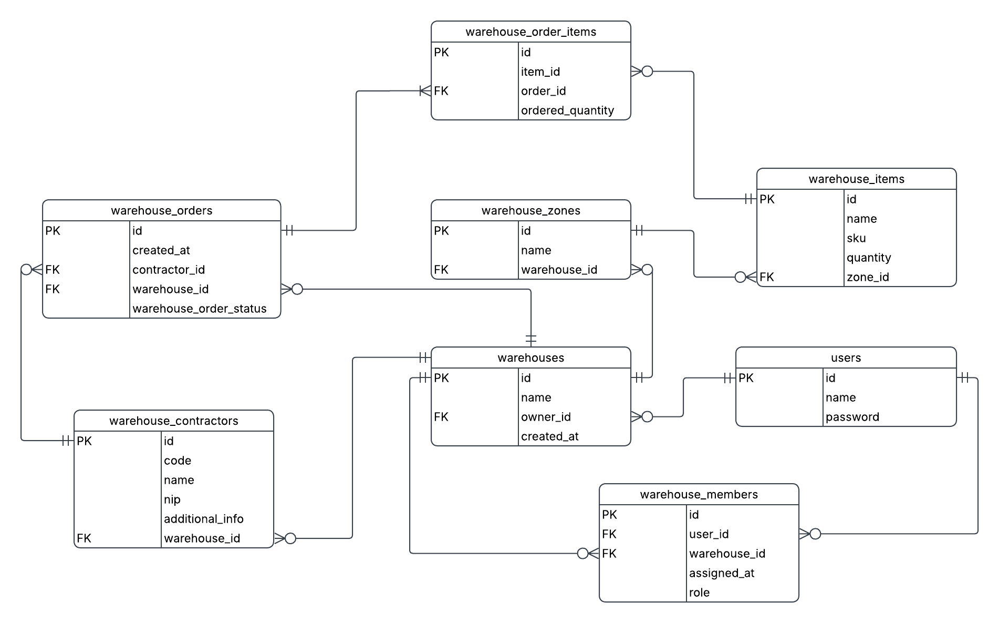

## Interface

### Login Page
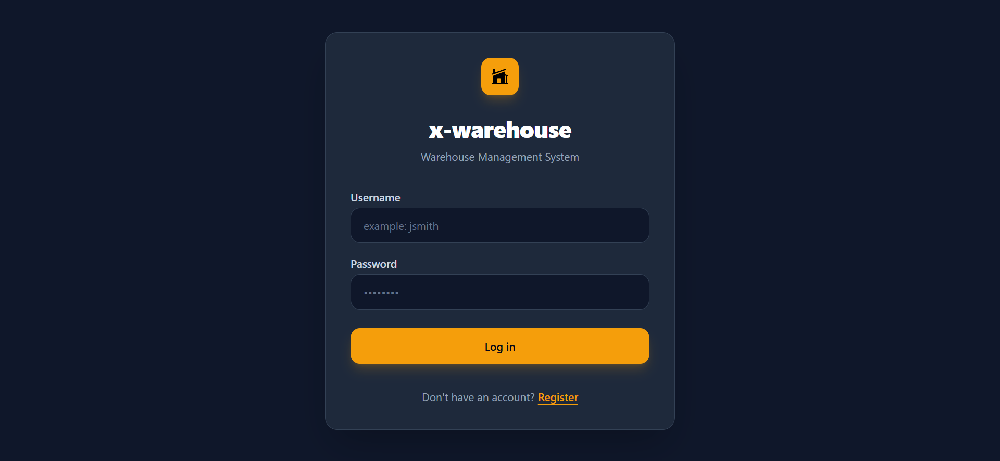

### Main Dashboard
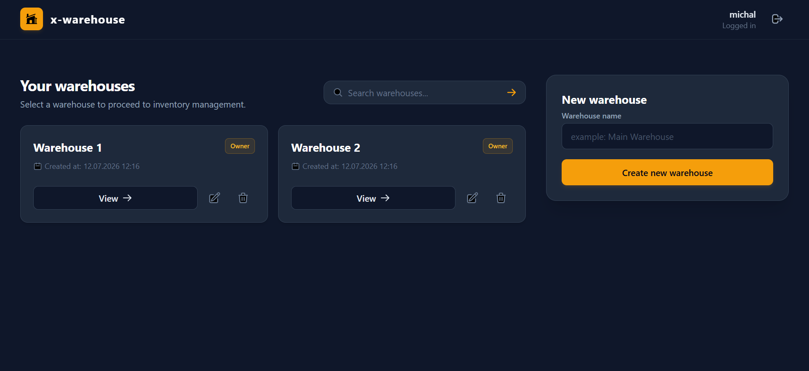

### Warehouse Management Panel
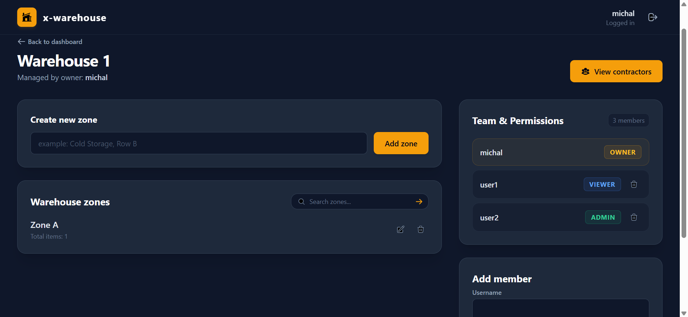

### Zone Management Panel
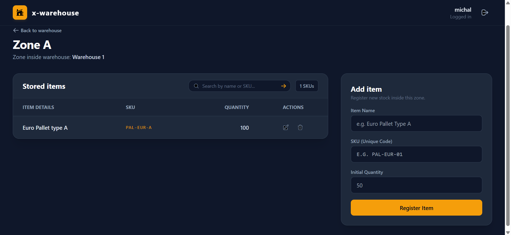

### Editing of a Stored Item
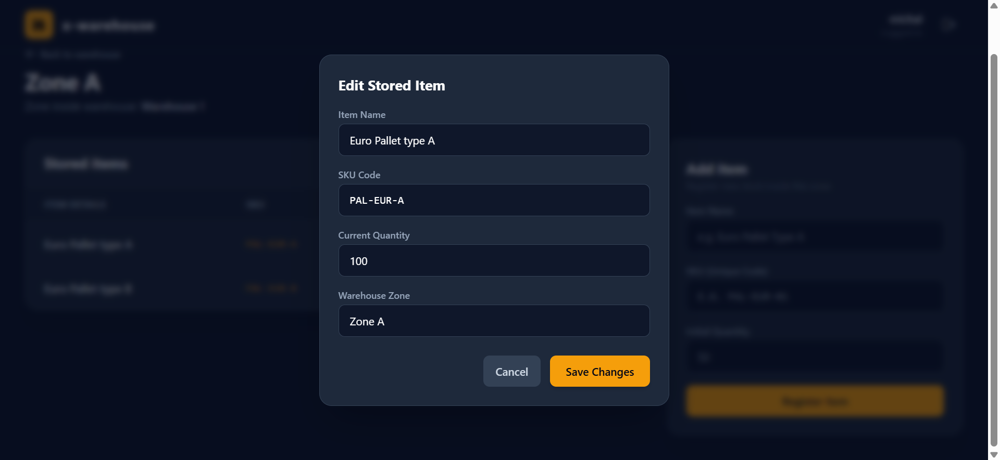

### Contractors Management Panel
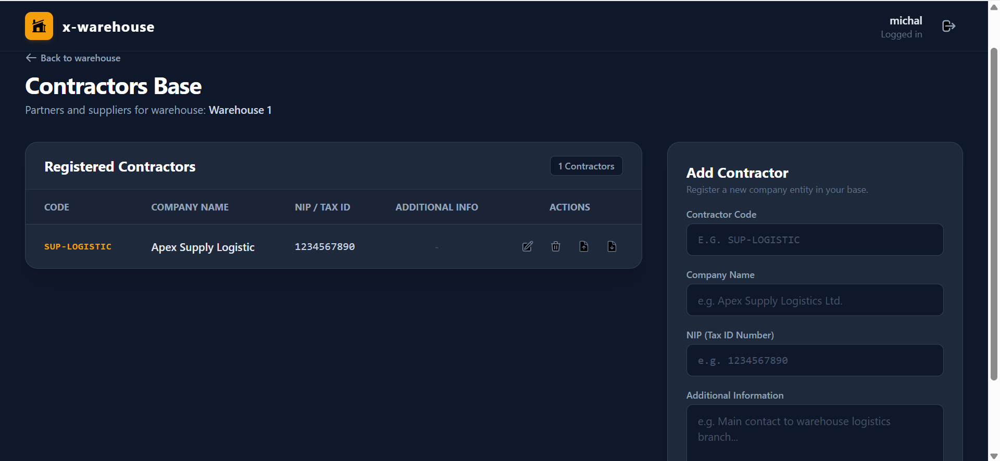
### Order Management Panel
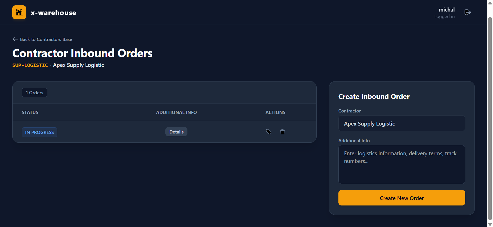
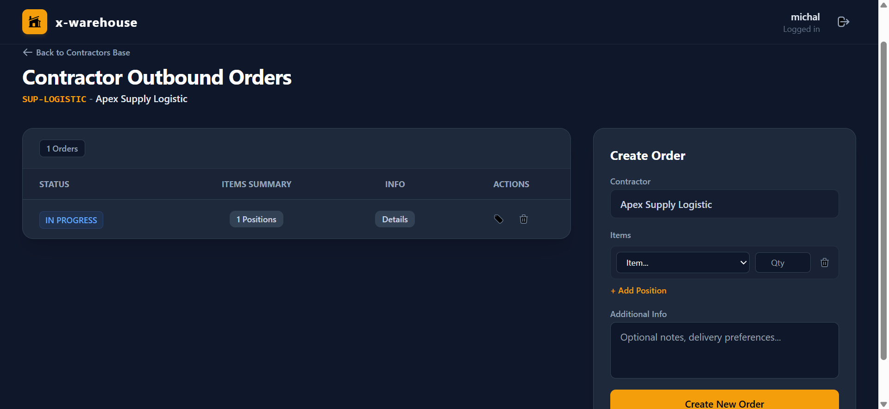

### Changing order status
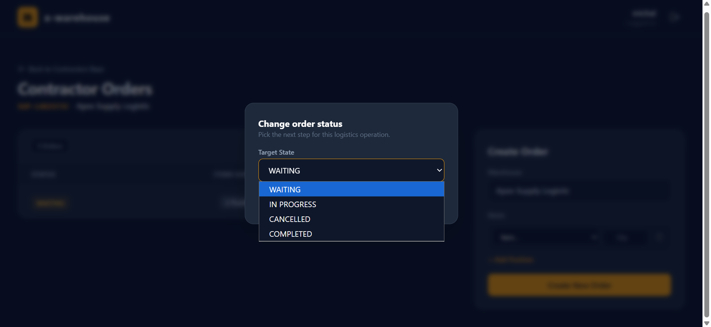

### Order Item Summary
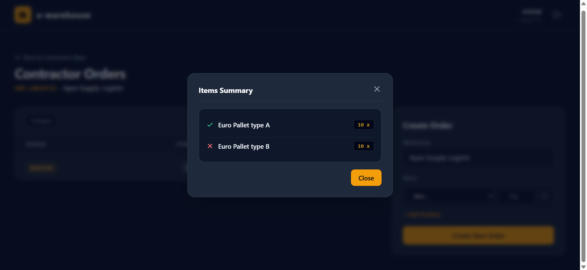